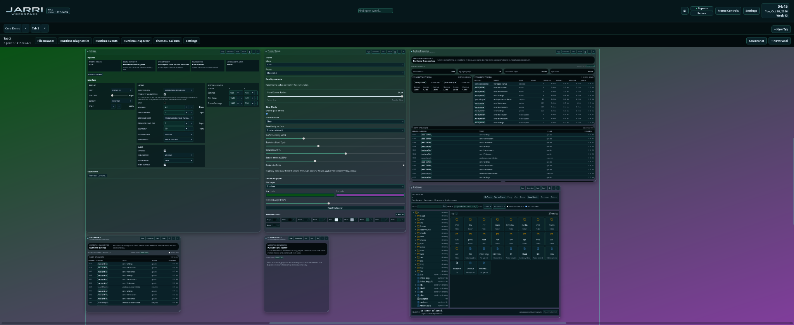

# Jarri Workspace Core

**Your workspace, your layout.**

Jarri Workspace Core is an open-source, customizable desktop
workspace. Arrange tools, information, and applications in movable
panels across persistent, zoomable tabs.

Browse files, open text and images, use the Calendar, customize
the appearance, and organize your tools in a workspace that
remembers how you left it.

Use the built-in panels, discover more through Add Panel, or
extend Workspace with modules of your own.

**Core provides the foundation. You decide what to build on it.**



> **Version 0.4.0 — release candidate.**
> This version is under final verification and has not yet
> been tagged or published. Core is distributed as adaptable
> source code, not as an automatically updated binary.

[What's new in 0.4.0](docs/releases/0.4.0.md) ·
[Changelog](CHANGELOG.md) ·
[Architecture documentation](docs/contracts/000001-workspace-core-architecture.md)

## How the workspace works

A workspace contains **tabs**. Each tab has a logical canvas that can be panned
and zoomed independently. The canvas contains **frames**, which users can move,
resize, minimize, restore, and arrange. A frame hosts a **panel** such as the
File Browser or Calendar. **Modules** register panels with the Workspace runtime
so the shell can discover, create, restore, and repair them.

For example, keep a File Browser and Text Viewer open in one tab, then create a
separate tab for a Calendar and Runtime Diagnostics. Tabs, panel geometry,
camera position, appearance preferences, and panel presentation state are saved
locally and restored on launch.

## Included in 0.4.0

- **Workspace navigation:** multiple persistent tabs, pan and zoom, configurable
  canvas bounds, movable/resizable/minimizable frames, and whole-workspace or
  individual-frame screenshots. Save and restore reusable tab templates when
  you want to reuse a panel setup.
- **Tab controls:** choose a horizontally scrollable or wrapping tab strip,
  optionally compress tab buttons, and drag tabs to reorder them. These options
  are in Settings and persist with workspace preferences.
- **Panel discovery:** Add Panel opens a searchable catalogue of registered
  modules and panels. Search across the workspace can also open a panel by name.
  Catalogue groups can be organized and its spatial layout adjusted; those
  catalogue controls are stored in browser local storage.
- **Everyday panels:** Settings, Calendar, Themes / Colours, Colour Picker,
  File Browser, Text Viewer, Image Viewer, and a recoverable Missing Panel
  surface. A demonstration module exercises semantic panel projections.
- **Files and resources:** browse and search the local filesystem, create
  folders, rename, delete, copy or cut items, and open supported text and image
  resources in Core viewers. Filesystem search is bounded and starts from the
  directory being browsed. Text reading is bounded; large text shows a
  truncation notice.
- **Appearance:** light/dark/system themes and presets, semantic color
  overrides, font and scale options, adjustable panel corners, optional glass
  effects, and an optional configurable gradient canvas wallpaper. The Dashboard
  Night palette is a community contribution and currently has no separate
  light-mode palette.
- **Workspace Diagnostics:** Runtime Diagnostics, Runtime Events, and Runtime
  Inspector expose Core runtime timing, selection, observation leases, and
  explicitly registered resource-byte evidence where available. This is
  instrumentation, not a process or GPU memory monitor. Core currently has no
  backend observation producer, so an empty observation list does not mean
  there is no backend activity.

## Customization and extension

Use **Settings** for workspace layout preferences and **Themes / Colours** for
appearance. Add Panel shows the panels registered by the running application.
Core stores workspace state separately from runtime truth and keeps unknown
panels as recoverable missing entries when their module is unavailable.

Developers can register modules and panel definitions through the Workspace
runtime, provide panel components and state normalization, and use generic
resource-opening, semantic projection, lifecycle observation, and persistence
contracts. The consuming application remains responsible for its services,
domain truth, and domain-specific panels; Core does not include Workspace Lab
or application integrations.

## Stable behavior and boundaries

Core's tab, panel, resource, theme, persistence, and catalogue paths are
implemented and covered by repository checks, but 0.4.0 remains a release
candidate pending integration and native release review. Specific limits:

- List virtualization is an opt-in presentation utility, not automatic
  virtualization of all panels. Runtime Events exposes an opt-in history mode;
  normal rendering is the default. Virtualization does not determine how many
  records a producer retains or materializes.
- Runtime lifecycle coordination observes panel membership and presentation;
  it does not suspend services, discard projections, or unmount offscreen
  panels as a new policy.
- Native filesystem access and the application host use Tauri. The separate
  adopted-window native surface host has Linux-specific implementation and
  remains experimental; it does not define a cross-platform plugin system.
- The update-awareness UI checks a configured source-release metadata endpoint
  only when requested. It can link to release information; it does not download
  or install a binary update.
- This repository is source-only as a release/distribution policy. Tauri
  packaging can produce local bundles, but no Core binary feed or automatic
  binary upgrade is provided here.

## Prerequisites and local development

Core is a source repository rather than a prebuilt application download. The
frontend uses Node.js/npm, React 19, TypeScript 5.8, and Vite 7. Running the
desktop host also requires Rust (the Tauri crate declares Rust 1.77.2 or newer),
the Tauri 2 platform prerequisites, and native libraries required by the target.
On Linux, the native dependencies include WebKitGTK and Cairo; see the official
[Tauri prerequisites](https://v2.tauri.app/start/prerequisites/) for the
platform-specific system packages. A clean-machine dependency recipe has not
been validated for this release candidate.

From the repository root:

```sh
npm install
npm run dev -- --host 127.0.0.1
```

The Vite server is useful for frontend work. Native commands such as filesystem
access need the Tauri host, which starts Vite on the configured port:

```sh
npm run tauri -- dev
```

Build and typecheck the frontend with:

```sh
npm run typecheck
npm run build
```

Run the Core regression suite with `npm run test:core`. The update-awareness,
appearance-contract, screenshot-contract, architecture-boundary, and native
control guards are available as `npm run test:update-awareness`,
`npm run test:appearance-contracts`,
`npm run test:workspace-screenshot-contract`,
`npm run test:architecture-boundary`, `npm run test:native-number-guard`, and
`npm run test:native-select-guard`.

## Documentation

- [0.4.0 release notes](docs/releases/0.4.0.md) — user-facing summary and
  limitations.
- [Changelog](CHANGELOG.md) — changes by release.
- [Workspace architecture contract](docs/contracts/000001-workspace-core-architecture.md)
  — runtime ownership, panels, navigation, native boundaries, and Diagnostics.
- [Layout persistence contract](docs/contracts/000003-layout-persistence-contract.md)
  — saved state, repair, and migration behavior.
- [Panel lifecycle contract](docs/contracts/000005-panel-lifecycle-contract.md)
  — implemented observations and explicit lifecycle limits.
- [Update awareness contract](docs/contracts/000004-update-awareness-contract.md)
  — source metadata format and update-status behavior.
- [Source audit](docs/investigations/000001-workspace-core-source-audit.md)
  — historical architectural investigation; it records the context at the time
  it was written and is not a current capability list.

## License

MIT
